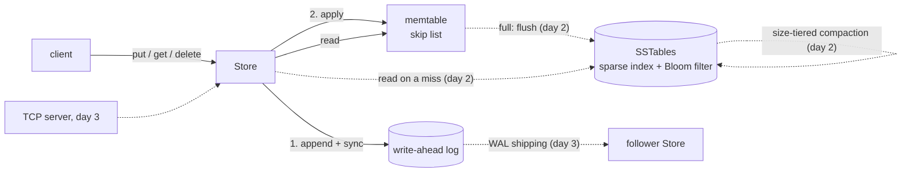

# Keystore design

Keystore is a key-value store built the way LevelDB and RocksDB are: writes go to a write-ahead log and an in-memory
sorted table (the memtable); full memtables are written out as immutable sorted files (SSTables) that compaction
merges; reads look in the memtable first and then in the files, newest first. On top of that sits a small TCP
server and leader-follower replication by shipping the write-ahead log.

It is a learning-sized system that tries to be exact about the parts that are hard: what a write's acknowledgement
promises, what a crash can leave on disk, and what recovery does with it.

This document is the plan for all five days and the detail for what exists. Day 1 (this version) builds the
memtable, the write-ahead log and recovery, and `put`/`get`/`delete` on top of them.

## Contents

- [Data model](#data-model)
- [Architecture](#architecture)
- [Write path (day 1)](#write-path-day-1)
- [Read path (day 1)](#read-path-day-1)
- [The memtable: a skip list (day 1)](#the-memtable-a-skip-list-day-1)
- [The write-ahead log (day 1)](#the-write-ahead-log-day-1)
- [Recovery (day 1)](#recovery-day-1)
- [Failures while running (day 1)](#failures-while-running-day-1)
- [Testing (day 1)](#testing-day-1)
- [Plan for days 2–5](#plan-for-days-25)
- [Limitations (day 1)](#limitations-day-1)

## Data model

- **Keys and values are byte strings.** A key is 1 to 65,536 bytes; a value is 0 to 16 MiB (16,777,216 bytes).
  The limits bound every record, so a reader can reject a damaged length field before allocating anything.
- **Keys are ordered bytewise, unsigned** (`Arrays.compareUnsigned`): `0x7f` sorts before `0x80`, and a key sorts
  before every longer key it is a prefix of. This is LevelDB's default comparator, and the SSTables (day 2) and
  range scans depend on it.
- **Every write has a sequence number**, a `long` starting at 1 and increasing by exactly one per write. The log
  records it, recovery checks the sequence has no gaps, and replication (day 3) will use it to say how far a follower
  has got.
- **A delete is a write.** It stores a tombstone, a marker that says "no value as of this sequence number". On day
  1 the tombstone only hides the key in the memtable; from day 2 it must also hide older values of the key in
  SSTables, so it can't be dropped until compaction has merged it with every older file.

## Architecture

Solid lines exist on day 1; dotted ones are the plan.

On day 1 a store directory holds two files:

| File | What it is |
|---|---|
| `LOCK` | Locked with `FileChannel.tryLock()` while a `Store` is open, so two processes (or two `Store`s in one process) never append to the same log. |
| `wal.log` | The write-ahead log, one record per write. |

## Write path (day 1)

`put(key, value)` and `delete(key)` run one at a time under the store's write lock:

1. Check the key and value against the limits, and that the store is open and hasn't failed (below).
2. Take the next sequence number.
3. Encode the record and append it to the log, all of it (a loop over `FileChannel.write`).
4. With `SyncPolicy.EVERY_WRITE` (the default), force the log to the device (`FileChannel.force(false)`).
5. Apply the write to the memtable.
6. Return. The write is now acknowledged.

The order is the point of a write-ahead log: nothing is visible in the memtable, and nothing is acknowledged, until
it's in the log. So a reader never sees a value that recovery would lose, under `EVERY_WRITE`.

**Sync policies.** `SyncPolicy.EVERY_WRITE` makes an acknowledged write survive a power loss or an OS crash, at
the cost of one device flush per write. `SyncPolicy.NEVER` hands each record to the OS (it is in the page cache when
`put` returns, so it survives the process being killed) but never forces it, except when the store is closed; an OS
crash or power loss can lose the most recent writes. Group commit, where concurrent writers share one flush, is the
usual answer to the cost of `EVERY_WRITE`; it's a candidate for day 4's benchmarks, not built yet.

**Why the writes are serialised.** One writer at a time makes the sequence numbers and the log order the same
thing, and it is what the skip list's concurrency model needs (next section). It also means a write waits for the
previous write's flush.

## Read path (day 1)

`get(key)` looks the key up in the memtable and returns the value, or nothing for a missing key or a tombstone. It
takes no lock (see the next section). Day 2 adds the SSTables: on a memtable miss, look in each file from newest to
oldest, asking its Bloom filter first, and stop at the first value or tombstone found.

Values are copied on the way in (a caller may reuse its array) and on the way out (a caller can't change the
memtable's copy).

## The memtable: a skip list (day 1)

The memtable is a hand-written skip list, `memtable.SkipList`, mapping keys to their newest entry (a sequence number
and a value or a tombstone). A skip list keeps keys sorted, like a balanced tree, but with a much simpler concurrent
read path, which is why LevelDB, RocksDB and HBase use one.

**Shape.** Every node is on level 0, a sorted linked list of all keys. A node is also on levels 1..h-1, where its
height h is chosen at random when it is inserted: each further level with probability 1/4, up to 12 levels. A search
starts at the top level of the head node and moves right while the next key is smaller, then down a level. The
expected cost is about `(1/p) · log_{1/p}(n)` comparisons, which is `2 · log2(n)` for both p = 1/2 and p = 1/4, but
p = 1/4 uses 1.33 pointers per node instead of 2. Twelve levels suit up to about 4^12 (16 million) keys; this is
LevelDB's choice too.

**One writer, any number of readers, no read locks.** The store's write lock guarantees one writer at a time. Readers
never lock. This is safe because of the order in which the writer publishes a new node:

1. It fills in the node: key, entry, and the node's own next pointers at every level.
2. It links the node in from the bottom up: level 0 first, then level 1, and so on. Each link is a volatile write
   (the next pointers are an `AtomicReferenceArray`).

A reader follows next pointers with volatile reads. Under the Java memory model, a volatile write happens-before every
volatile read that sees it, so a reader that reaches the new node through any link also sees everything the writer
wrote before that link: the key, the entry and the node's own pointers. A reader can therefore never see a
half-built node. It may see the node on level 0 but not yet on level 2; it then finds it by going down, which is only
slower. Nodes are never removed, so a reader never follows a pointer into a node that's gone.

The list's height is a volatile too. The writer raises it before linking the new node in at the new levels, so a
reader may see the new height and a null next pointer at the head's top level; it treats null as "past the end" and
goes down, which is correct.

**Overwrites replace the entry in place.** A put for a key that's already there swaps the node's entry (one volatile
write of an immutable `Entry`), so a reader sees the old entry or the new one, never a mix. The memtable keeps only
the newest version of each key: there are no snapshots on day 1 (if day 4's snapshots need old versions, the key
becomes (user key, sequence number), as in LevelDB).

**Iteration** walks level 0 in key order. It is weakly consistent while a writer runs, like
`ConcurrentSkipListMap`'s: it sees each key's entry as of the moment it visits it. Day 2's flush iterates a memtable
no one writes to any more, so it sees a fixed state.

**Size.** The memtable counts the bytes of its keys and current values plus a fixed overhead per key
(`approximateBytes`). The overhead, 96 bytes, is measured (`Bench memory`): 64 bytes of node, next-pointer array
and entry, plus the key's and value's 16-byte array headers; it is exact for lengths that are multiples of 8 and
otherwise low by the arrays' padding. An overwrite replaces the entry, so a million overwrites of one key leave a
tiny memtable and a large log: day 2's flush must be triggered by the log's size (`Store.logSize()`, which counts
every record and its framing), not by the memtable's. A review found that an earlier count of "bytes written" kept
in the memtable left out the framing, 21 to 25 bytes a record, and was 22 times too small for 1-byte deletes; it
was removed.

## The write-ahead log (day 1)

### Record format

All integers are big-endian. One record per write:

| Offset | Size | Field |
|---|---|---|
| 0 | 4 | `length`: the payload's size in bytes, n |
| 4 | 4 | `checksum`: CRC32C of the 4 `length` bytes followed by the n payload bytes |
| 8 | 8 | `seq`: the sequence number |
| 16 | 1 | `op`: 1 = put, 2 = delete |
| 17 | 4 | key length k (1 to 65,536) |
| 21 | k | key |
| 21 + k | 4 | value length v, put only (0 to 16,777,216) |
| 25 + k | v | value, put only |

A delete with a 1-byte key is the smallest payload, 14 bytes; the largest is a put with the biggest key and value.
A length outside that range can only be damage, and a reader rejects it before reading the payload.

**Why CRC32C.** It detects every burst error up to 32 bits and, for random damage, misses with probability 2^-32.
`java.util.zip.CRC32C` uses the CPU's CRC instructions (ARMv8 here, SSE 4.2 on x86), so the checksum costs little
next to the write. (Checked here: `java -XX:+UnlockDiagnosticVMOptions -XX:+PrintFlagsFinal -version` shows
`UseCRC32CIntrinsics = true`, and `sysctl hw.optional.armv8_crc32` is 1.) The checksum covers the length too, so a damaged length is caught even in the unlikely case that
the bytes it points to happen to form a valid payload.

**A record that passes its checksum is also checked for structure**: a known op, lengths within the limits, and
fields that fill the payload exactly. A record with a valid checksum and a bad structure means a bug, and is treated
as damage.

### Appending

The log is a file opened for writing at its end. A record is encoded into one buffer and written with a loop over
`FileChannel.write` until every byte is out (for a regular file that is usually one call). Under
`EVERY_WRITE` the store then calls `force(false)`: `fdatasync` on Linux, which also persists the file's length when
it grew; on macOS the JDK issues `fcntl(F_FULLFSYNC)`, which flushes the drive's own cache, where a plain `fsync`
does not. That last claim is checked, not assumed: in this machine's JDK (Homebrew OpenJDK 21.0.12),
`otool -tV $JAVA_HOME/lib/libnio.dylib` shows `Java_sun_nio_ch_FileDispatcherImpl_force0` calling `fcntl` with
`0x33` (51, `F_FULLFSYNC`), and falling back to `fsync` only when that fails on a filesystem that isn't local. It
is why a forced write costs milliseconds here (README, "Results").

When the store creates the log, it also forces the directory, so the file's directory entry survives a crash.

## Recovery (day 1)

`Store.open` replays the log into an empty memtable before accepting writes.

### What a crash can leave behind

- **Under `EVERY_WRITE`**, a write starts only after the previous write's flush has returned, so at most one record,
  the last, can be incomplete: some of its bytes reached the device and some didn't, or the file's length grew
  before the data did (the missing part then reads as zeros). Every earlier record was acknowledged and is intact.
- **Under `NEVER`**, a killed process loses nothing that `put` returned for: the records are in the OS's page
  cache. A power loss or OS crash can lose or tear any of the records written since the OS last wrote the file
  back, in any order of pages.
- **Damage that isn't a crash** (a bad sector, a bit flip, a bug elsewhere) can hit any record, including old ones
  that were acknowledged long ago.

### The procedure

1. Read the file and decode records from offset 0, checking each one's length bounds, checksum, structure, and that
   its sequence number is exactly one more than the previous record's (the first is 1). Apply each good record to
   the memtable.
2. Stop at the first record that fails any check, or at the end of the file.
3. If the end of the file was reached, the log is clean.
4. Otherwise, look at everything after the first bad record: try to decode an intact record at every byte offset
   after the bad record's start.
   - **No intact record anywhere after it: a torn tail.** This is what a crash leaves. Truncate the file to the end
     of the last good record, force it, and open. Nothing acknowledged was lost under `EVERY_WRITE`.
   - **An intact record after it: damage in the middle.** Records written after the damage exist, so acknowledged
     writes would be lost by stopping here. What happens depends on `RecoveryMode`:
     - `TOLERATE_TORN_TAIL` (the default) refuses to open: `WalCorruptionException` with the offset of the damage
       and what was found after it. An operator can inspect the log and then choose to drop the rest.
     - `POINT_IN_TIME` opens with the state as of the last good record, truncates the log there, and reports the
       bytes it dropped and the first intact record it found after the damage. (`keystore dump` lists them all.)
5. Truncation is forced before any new record is appended. Otherwise a crash after new appends could leave the old
   bytes beyond the new records, and a later recovery would find them.

`Store.recovery()` returns the report of the open: the outcome (clean, torn tail, damage dropped), records
replayed, the last sequence number, bytes kept and bytes truncated, and what was wrong.

### Why fail closed by default

The scan in step 4 is the line between "a crash happened" (normal, silent) and "data was damaged" (lost writes). It
errs on the side of refusing: any intact record after the damage counts, even one that turns out to be a copy of a
record stored inside a value (a value that holds an encoded log record; there's a test that shows it). A false
refusal costs an operator a decision; a false "torn tail" would silently drop acknowledged writes. Under `NEVER` a
power loss can legitimately leave intact records after a torn one, so with `NEVER`, `POINT_IN_TIME` is the
sensible mode.

The scan visits every byte offset after the damage, but checks the cheap fields first (a plausible length, a known
op, a key length and a value length that fill the payload exactly) and computes a checksum only where all of them
pass, so on zeros or random bytes it costs a few comparisons per offset (README, "Results"). A false match needs
all those fields and a 1-in-2^32 checksum match at once.

### Sequence numbers in recovery

A gap or a repeat in the sequence numbers fails the same way as a bad checksum. A checksum can't catch a record that
is intact but in the wrong place (old bytes left beyond a truncation, say); the sequence check can.

## Failures while running (day 1)

- **A failed append or flush stops the store's writes.** After an `IOException` from `write` or `force`, the log's
  state is unknown: part of a record may be on disk, and a failed `fsync` may have dropped the dirty pages it was
  meant to write (PostgreSQL's "fsyncgate", 2018), so retrying the flush can falsely succeed. The store records the
  failure, refuses every later write with it, and keeps serving reads. Reopening runs recovery, which truncates any
  partial record.
- **The outcome of a failed write is unknown.** The caller got an exception, but the record may have reached the
  device; if it did, recovery replays it. This is the same as any timeout in a distributed system, and it's why
  replication (day 3) identifies writes by sequence number.
- **One process at a time.** `Store.open` takes `LOCK` with `FileChannel.tryLock`; a second open fails at once
  with `StoreLockedException`, in another process or in the same JVM. The same-JVM case needs care. These are POSIX
  record locks: they belong to the process, not to a channel, and closing *any* descriptor for the file releases
  all of them. A second open that opened `LOCK`, failed to lock it (Java reports `OverlappingFileLockException`)
  and closed its channel would silently release the first store's lock, and another process could then open the
  directory while the first store is still writing. So the store keeps a JVM-wide set of open directories (by real
  path, so a symlink or a `..` path is the same directory) and refuses a second open before touching `LOCK`. Lucene's
  `NativeFSLockFactory` keeps the same kind of set for the same reason. A test runs a child JVM to show the lock
  holds after a refused second open; without the set, the child opens the directory.
- **An interrupted writer stops the store's writes.** `FileChannel` is an interruptible channel: if a thread is
  interrupted while in (or entering) a channel operation, the JDK closes the channel and throws
  `ClosedByInterruptException`. The log's channel is shared, so one interrupted writer fails the store as above,
  and every later write gets `StoreFailedException` until a reopen; reads go on. Callers must not interrupt
  threads that write. The fix is to do the log's I/O on a thread of its own, which group commit (day 4) needs anyway.
- **Close** forces the log (whatever the sync policy), closes it and releases the lock. Calls after `close` fail
  with `IllegalStateException`. `close` waits for a write in progress, since it takes the write lock. A store whose
  writes failed closes its log without forcing it: a flush after a failed one proves nothing, and after an
  interrupt the channel is already closed.

**Inspecting a log.** `keystore dump DIR` (README, "Run it") reads the log without changing it, lists every record
with its offset, and says what recovery would do. For a log the default refuses, it lists the intact records after
the damage, which `POINT_IN_TIME` would drop, so the operator can decide with the facts in front of them.

## Testing (day 1)

- **The skip list against a model.** Seeded random sequences of puts and gets, checked step by step against
  `java.util.TreeMap`, plus the iteration order; with small and large key spaces, and with keys that are prefixes of
  each other.
- **Concurrent readers.** One writer inserts keys and publishes how far it has got through a volatile counter; reader
  threads read the counter and then check that every key up to it is found with its value, and that iteration is
  sorted. Reading the counter gives the reader a happens-before edge with every insert before it, so a miss would be
  a real bug, not a timing accident.
- **The record codec.** Round trips at the limits, and rejection of each kind of bad record.
- **Recovery, exhaustively.** For a small log: truncate it at every byte offset and check recovery gives exactly the
  records that ended before the cut; flip each bit of the log (or of chosen records) and check the outcome is right
  for where the flip landed; zero-filled and garbage tails; a damaged length that would allocate gigabytes; out-of-
  sequence records.
- **The store.** Put, get and delete through reopen, both sync policies, the lock (with a child JVM), and failures:
  a log channel that fails a write partway or fails a flush on demand (`FaultyChannel`), and an interrupted writer.
- **Do the tests fail when they should?** Each mechanism below was removed (in a copy of the file) to check that a
  test fails without it: linking a skip list node before filling it in (all 3 runs of the concurrency test fail
  within 0.2 s), the JVM-wide set of open directories (the child JVM opens a directory that is still open), marking
  the store failed after an error (5 of 5 fault tests fail), and closing a failed log without forcing it (3 of 5).

## Plan for days 2–5

- **Day 2: SSTables and compaction.**
  - When the log passes a size threshold, freeze the memtable, start a new log and memtable, and flush the
    frozen one to an SSTable: sorted data blocks, a sparse index (one key per block), a Bloom filter over the keys,
    a footer with offsets and a checksum.
  - A manifest records the live SSTables and the sequence number they cover; a log is deleted only after its
    SSTable is durable and in the manifest. Recovery loads the manifest and replays only newer logs.
  - Reads: memtable, frozen memtable, then SSTables newest first, each asked through its Bloom filter.
  - Size-tiered compaction: merge similar-sized SSTables, keep the newest version of each key, drop tombstones only
    when merging into the oldest file.
- **Day 3: the server and replication.** A TCP server with a small line-based text protocol (`PUT`, `GET`, `DEL`,
  lengths before binary data); leader-follower replication by shipping log records with their sequence numbers;
  a follower that falls behind catches up from its last applied sequence number.
- **Day 4: failure and measurement.** Crash tests that kill a writing process (`kill -9` of a child JVM) and check
  every acknowledged write; checksum failures in SSTables; snapshots; JMH benchmarks of write and read throughput and
  of the Bloom filter's effect. Group commit is a candidate optimisation.
- **Day 5:** README with results, WALKTHROUGH.md, v1.0.0.

## Limitations (day 1)

- Everything is in memory: there are no SSTables yet, so the data set must fit in the heap, and the log is never
  trimmed.
- Recovery reads the whole log file into memory (one array, so at most 2 GiB). Day 2's log rotation keeps each file
  near the memtable's size.
- Writes are serialised, and under `EVERY_WRITE` each one waits for a device flush; there is no group commit.
- Damage to the last record is indistinguishable from a torn write, so it is dropped as one, even if that record had
  been acknowledged.
- A value that contains an encoded log record can make recovery refuse to open after an ordinary crash (see "Why
  fail closed by default"). `POINT_IN_TIME` opens it.
- No snapshots or range scans in the API yet; the memtable can iterate, for the flush.
