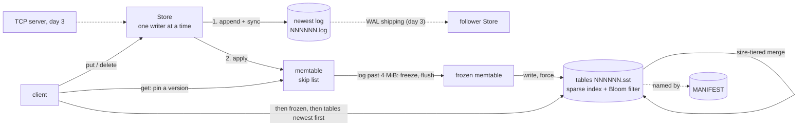

# Keystore design

Keystore is a key-value store built the way LevelDB and RocksDB are: writes go to a write-ahead log and an in-memory
sorted table (the memtable); full memtables are written out as immutable sorted files (SSTables) that compaction
merges; reads look in the memtable first and then in the files, newest first. On top of that sits a small TCP
server and leader-follower replication by shipping the write-ahead log.

It is a learning-sized system that tries to be exact about the parts that are hard: what a write's acknowledgement
promises, what a crash can leave on disk, and what recovery does with it.

This document is the plan for all five days and the detail for what exists. Day 1 built the memtable, the
write-ahead log and recovery, and `put`/`get`/`delete` on top of them. Day 2 (this version) adds the rest of the LSM
tree: tables (SSTables) with a sparse index and a Bloom filter, the flush that writes them, a manifest, reads across
the memtable and the tables, and size-tiered compaction.

## Contents

- [Data model](#data-model)
- [Architecture](#architecture)
- [Write path](#write-path)
- [Read path](#read-path)
- [The memtable: a skip list (day 1)](#the-memtable-a-skip-list-day-1)
- [The write-ahead log (day 1)](#the-write-ahead-log-day-1)
- [Tables (day 2)](#tables-day-2)
- [The flush (day 2)](#the-flush-day-2)
- [The manifest (day 2)](#the-manifest-day-2)
- [Versions: reads during flushes and merges (day 2)](#versions-reads-during-flushes-and-merges-day-2)
- [Compaction (day 2)](#compaction-day-2)
- [Recovery](#recovery)
- [Failures while running](#failures-while-running)
- [Testing](#testing)
- [Plan for days 3–5](#plan-for-days-35)
- [Limitations](#limitations)

## Data model

- **Keys and values are byte strings.** A key is 1 to 65,536 bytes; a value is 0 to 16 MiB (16,777,216 bytes).
  The limits bound every record, so a reader can reject a damaged length field before allocating anything.
- **Keys are ordered bytewise, unsigned** (`Arrays.compareUnsigned`): `0x7f` sorts before `0x80`, and a key sorts
  before every longer key it is a prefix of. This is LevelDB's default comparator, and the tables (day 2) and
  range scans depend on it.
- **Every write has a sequence number**, a `long` starting at 1 and increasing by exactly one per write. The log
  records it, recovery checks the sequence has no gaps, and replication (day 3) will use it to say how far a follower
  has got.
- **A delete is a write.** It stores a tombstone, a marker that says "no value as of this sequence number". It
  hides older values of the key in the memtable and in older tables, so it is kept, through flushes and merges,
  until a merge reaches the oldest table, where nothing older is left for it to hide (see "Compaction").

## Architecture



Solid lines exist (day 2); dotted ones are the plan, except the manifest's, which is a reference, not a data flow.

A store directory holds:

| File | What it is |
|---|---|
| `LOCK` | Locked with `FileChannel.tryLock()` while a `Store` is open, so two processes (or two `Store`s in one process) never append to the same log. |
| `MANIFEST` | The live tables, newest first, the oldest log recovery must replay, and the next file number. The only file that says what the others mean. |
| `NNNNNN.log` | Write-ahead logs, one record per write. Only the newest takes writes; an older one exists only until the table holding its writes is in the manifest. |
| `NNNNNN.sst` | Tables: sorted, immutable, each holding a contiguous range of sequence numbers. |
| `MANIFEST.tmp` | A manifest being written; renamed over `MANIFEST` when complete. |

Logs and tables are numbered from one counter, so a number names one file whatever its kind.

## Write path

`put(key, value)` and `delete(key)` run one at a time under the store's write lock:

1. Check the key and value against the limits, and that the store is open and hasn't failed (below).
2. If the log has reached `Options.flushLogBytes` (4 MiB by default), flush the memtable to a table and start a new
   log, then run any merge that is due ("The flush", "Compaction"). The write waits for both; a failure there fails
   the write, which was not made.
3. Take the next sequence number.
4. Encode the record and append it to the log, all of it (a loop over `FileChannel.write`).
5. With `SyncPolicy.EVERY_WRITE` (the default), force the log to the device (`FileChannel.force(false)`).
6. Apply the write to the memtable.
7. Return. The write is now acknowledged.

The order is the point of a write-ahead log: nothing is visible in the memtable, and nothing is acknowledged, until
it's in the log. So a reader never sees a value that recovery would lose, under `EVERY_WRITE`.

**Sync policies.** `SyncPolicy.EVERY_WRITE` makes an acknowledged write survive a power loss or an OS crash, at
the cost of one device flush per write. `SyncPolicy.NEVER` hands each record to the OS (it is in the page cache when
`put` returns, so it survives the process being killed) but never forces it, except when a flush starts a new log
and when the store is closed; an OS crash or power loss can lose the most recent writes. Group commit, where concurrent writers share one flush, is the
usual answer to the cost of `EVERY_WRITE`; it's a candidate for day 4's benchmarks, not built yet.

**Why the writes are serialised.** One writer at a time makes the sequence numbers and the log order the same
thing, and it is what the skip list's concurrency model needs (next section). It also means a write waits for the
previous write's flush.

## Read path

`get(key)` takes no lock. It pins the current version (see "Versions") and looks, in order, in:

1. the memtable taking writes;
2. the frozen memtable, if a flush is writing one out;
3. each table, newest first. A table whose key range doesn't cover the key, or whose Bloom filter says the key
   isn't there, is skipped without a disk read; otherwise one data block is read (see "Tables").

It stops at the first value or tombstone it finds: a value is returned, a tombstone means "deleted", and nothing
anywhere means the key was never written (or was deleted and the tombstone has since been merged away with every
older value). Newest first is correct because each source holds only writes newer than every source after it: the
memtable's writes are newer than the frozen one's, which are newer than any table's, and tables are kept in the
order of the sequence numbers they cover.

Values are copied on the way in (a caller may reuse its array) and on the way out (a caller can't change the
memtable's copy).

## The memtable: a skip list (day 1)

The memtable is a hand-written skip list, `memtable.SkipList`, mapping keys to their newest entry (a sequence number
and a value or a tombstone). A skip list keeps keys sorted, like a balanced tree, but with a much simpler concurrent
read path, which is why LevelDB, RocksDB and HBase use one.

**Shape.** Every node is on level 0, a sorted linked list of all keys. A node is also on levels 1..h-1, where its
height h is chosen at random when it is inserted: each further level with probability 1/4, up to 12 levels. A search
starts at the top level of the head node and moves right while the next key is smaller, then down a level. The
expected cost is about `(1/p) · log_{1/p}(n)` comparisons, which is `2 · log2(n)` for both p = 1/2 and p = 1/4, but
p = 1/4 uses 1.33 pointers per node instead of 2. Twelve levels suit up to about 4^12 (16 million) keys; this is
LevelDB's choice too.

**One writer, any number of readers, no read locks.** The store's write lock guarantees one writer at a time. Readers
never lock. This is safe because of the order in which the writer publishes a new node:

1. It fills in the node: key, entry, and the node's own next pointers at every level.
2. It links the node in from the bottom up: level 0 first, then level 1, and so on. Each link is a volatile write
   (the next pointers are an `AtomicReferenceArray`).

A reader follows next pointers with volatile reads. Under the Java memory model, a volatile write happens-before every
volatile read that sees it, so a reader that reaches the new node through any link also sees everything the writer
wrote before that link: the key, the entry and the node's own pointers. A reader can therefore never see a
half-built node. It may see the node on level 0 but not yet on level 2; it then finds it by going down, which is only
slower. Nodes are never removed, so a reader never follows a pointer into a node that's gone.

Bottom-up linking isn't needed for a reader to see a whole node (the node is complete before any link), but it is
needed for visibility to be monotonic: once any search can find the node, on any level, it is on level 0, so every
later search and every later iteration finds it too. Linked top-down, a `get` could find a key through an upper
level that an iteration starting after the `get` returned would miss, while the put was still in progress.

The list's height is a volatile too. The writer raises it before linking the new node in at the new levels, so a
reader may see the new height and a null next pointer at the head's top level; it treats null as "past the end" and
goes down, which is correct. (A reader that saw a stale, lower height would just start lower, so the volatile is for
clarity, not for safety.)

**Overwrites replace the entry in place.** A put for a key that's already there swaps the node's entry (one volatile
write of an immutable `Entry`), so a reader sees the old entry or the new one, never a mix. The memtable keeps only
the newest version of each key: there are no snapshots on day 1 (if day 4's snapshots need old versions, the key
becomes (user key, sequence number), as in LevelDB).

**Iteration** walks level 0 in key order. It is weakly consistent while a writer runs, like
`ConcurrentSkipListMap`'s: it sees each key's entry as of the moment it visits it. The flush iterates a frozen
memtable, which no one writes to any more, so it sees a fixed state.

**Size.** The memtable counts the bytes of its keys and current values plus a fixed overhead per key
(`approximateBytes`). The overhead, 96 bytes, is measured (`Bench memory`): 64 bytes of node, next-pointer array
and entry, plus the key's and value's 16-byte array headers; it is exact for lengths that are multiples of 8 and
otherwise low by the arrays' padding. An overwrite replaces the entry, so a million overwrites of one key leave a
tiny memtable and a large log: the flush is triggered by the log's size (`Store.logSize()`, which counts every record
and its framing), not by the memtable's, since it is the log that recovery has to replay. A review found that an earlier count of "bytes written" kept
in the memtable left out the framing, 21 to 25 bytes a record, and was 22 times too small for 1-byte deletes; it
was removed.

## The write-ahead log (day 1)

### Record format

All integers are big-endian. One record per write:

| Offset | Size | Field |
|---|---|---|
| 0 | 4 | `length`: the payload's size in bytes, n |
| 4 | 4 | `checksum`: CRC32C of the 4 `length` bytes followed by the n payload bytes |
| 8 | 8 | `seq`: the sequence number |
| 16 | 1 | `op`: 1 = put, 2 = delete |
| 17 | 4 | key length k (1 to 65,536) |
| 21 | k | key |
| 21 + k | 4 | value length v, put only (0 to 16,777,216) |
| 25 + k | v | value, put only |

A delete with a 1-byte key is the smallest payload, 14 bytes; the largest is a put with the biggest key and value.
A length outside that range can only be damage, and a reader rejects it before reading the payload.

**Why CRC32C.** It detects every burst error up to 32 bits and, for random damage, misses with probability 2^-32.
`java.util.zip.CRC32C` uses the CPU's CRC instructions (ARMv8 here, SSE 4.2 on x86), so the checksum costs little
next to the write. (Checked here: `java -XX:+UnlockDiagnosticVMOptions -XX:+PrintFlagsFinal -version` shows
`UseCRC32CIntrinsics = true`, and `sysctl hw.optional.armv8_crc32` is 1.) The checksum covers the length too, so a damaged length is caught even in the unlikely case that
the bytes it points to happen to form a valid payload.

**A record that passes its checksum is also checked for structure**: a known op, lengths within the limits, and
fields that fill the payload exactly. A record with a valid checksum and a bad structure means a bug, and is treated
as damage.

### Appending

The log is a file opened for writing at its end. A record is encoded into one buffer and written with a loop over
`FileChannel.write` until every byte is out (for a regular file that is usually one call). Under
`EVERY_WRITE` the store then calls `force(false)`: `fdatasync` on Linux, which also persists the file's length when
it grew; on macOS the JDK issues `fcntl(F_FULLFSYNC)`, which flushes the drive's own cache, where a plain `fsync`
does not. That last claim is checked, not assumed: in this machine's JDK (Homebrew OpenJDK 21.0.12),
`otool -tV $JAVA_HOME/lib/libnio.dylib` shows `Java_sun_nio_ch_FileDispatcherImpl_force0` calling `fcntl` with
`0x33` (51, `F_FULLFSYNC`), and falling back to `fsync` only when that fails on a filesystem that isn't local. It
is why a forced write costs milliseconds here (README, "Results").

Every open forces the log's directory, so the file's directory entry survives a crash. That's every open, not only
the one that created the file: a crash between creating it and forcing the directory would otherwise leave the
entry unforced for good (a review found that). When `Store.open` creates the store's directory, and any missing
directories above it, it forces the parent of each one it created, top down.

**A limit on the log's size.** Recovery reads the log whole, into one array, so it can't read back more than about
2 GiB (`WriteAheadLog.MAX_RECOVERABLE_BYTES`). A write that would take the log past `Options.maxLogBytes` (at most
that, and that by default) is refused with `LogFullException` before anything is written, and the store goes on.
Before a review found it, the store acknowledged writes past the limit and then couldn't reopen. Since day 2 a flush
starts a new log every 4 MiB, so the limit matters only if it is set below the flush threshold.

## Tables (day 2)

A table (`sstable.Table`, written by `sstable.TableWriter`) is a sorted, immutable file of entries: each key once,
with its newest entry (a sequence number and a value, or a tombstone). It is written once, in key order, forced, and
never changed; a merge writes a new one. All integers are big-endian.

| Part | Contents |
|---|---|
| Data blocks | Entries one after another: key length (4), key, sequence number (8), kind (1 = value, 2 = tombstone), and for a value its length (4) and bytes. A block is cut once it reaches `Options.blockBytes` (4 KiB), so an entry bigger than that (a value can be 16 MiB) makes a block of its own. |
| Filter block | The Bloom filter over every key in the table. |
| Index block | The table's smallest key, then one entry per data block: its last key, offset and length. |
| Footer | Fixed size (72 bytes), at the very end: the filter's and the index's offsets and lengths, counts of entries and tombstones, the smallest and largest sequence numbers, a format version, the footer's own CRC32C, and a magic number. |

**Every block ends in a 4-byte trailer: the CRC32C of the block's offset in the file, then the block's bytes.** The
offset is in the checksum because a review found that bytes alone weren't enough: two data blocks of the same length
swapped, or one written over another (a misdirected write), passed every check, and a lookup in such a block found
no key and said "not here". The store would then have read on to an older table and returned an overwritten value.
With the offset in it, a block read from the wrong place fails its checksum. (`TableTest`
`swappedBlocksOfEqualLengthFailTheirChecksums`.)

**Opening a table** reads the footer and checks the magic, the checksum, the version and that the layout tiles the
file exactly (data blocks, then the filter and its trailer, then the index and its trailer, then the footer). Then
it reads the filter and the index, checks their trailers, and checks the index: block offsets tile the data region in
order, last keys strictly increase, and the block count fits in the index's length before anything is allocated for
it. (A review built a file whose checksums were all valid and whose index claimed 2^31 blocks: the reader allocated
three arrays of that size and died of an `OutOfMemoryError`.) The filter and the index stay in memory; the data
blocks stay on disk.

**A lookup** (`Table.get`) reads at most one data block:

1. If the key is outside the table's smallest and largest keys, or the Bloom filter rules it out, return "not here".
2. Binary-search the index for the first block whose last key is at least the key. That is the only block that can
   hold it: every block before it ends below the key.
3. Read that block with one positional read (`FileChannel.read(buffer, position)`, which any number of threads can
   do at once), check its trailer, and scan its entries, stopping at the key or at the first larger one.

The index is sparse, one key per 4 KiB block rather than one per entry, so it stays small enough to keep in memory
for every table: an index entry is 16 bytes plus the key, and a 4 KiB block of 16-byte keys and 100-byte values holds
31 entries of 133 bytes, so the index is under 1% of the data. The cost is the scan within a block, a few dozen
comparisons.

**A cursor** (`Table.Cursor`) reads every entry in order, a block at a time, for merges. It checks that keys strictly
increase across blocks, that each block ends with the key the index has for it, and that the count matches the
footer's, so a merge never copies an inconsistent table into a new one.

**The Bloom filter** (`sstable.BloomFilter`) answers "definitely not here" or "maybe". Each key sets k bits of an
m-bit array, chosen by double hashing one 64-bit hash: probe i is `h + i * delta` (Kirsch and Mitzenmacher; LevelDB's
filter does the same with a 32-bit hash). The hash is MurmurHash64A with a fixed seed, pinned by a test to the
reference C implementation's output (`scripts/murmur64a.c`), since files store filters built with it. With b bits a
key, the false-positive rate is about `(1 - e^(-k/b))^k`, lowest at `k = b ln 2`: for the default 10 bits a key,
k = 7 and about 0.82%. `BloomFilterTest` measures 0.90% (100,000 absent keys against 10,000 present), and 9.12% at 5
bits against the formula's 9.2%. A filter costs 10 bits, 1.25 bytes, a key, in memory for every table.

## The flush (day 2)

When a write finds the log at `Options.flushLogBytes` or more, it first flushes (`Store.flushMemtable`, under the
write lock):

1. **Close the log and start a new one.** Closing forces the old log, whatever the sync policy, and the new log's
   directory entry is forced when it is created. From here on the old log is complete on the device, which is what
   lets recovery insist that only the newest log can end in a torn write.
2. **Freeze the memtable.** A new version is installed with a new, empty memtable for writes and the old one as the
   frozen memtable, so reads still find its keys while it is written out.
3. **Write the table.** Iterate the frozen memtable in key order into a new table file, and force it.
4. **Force the directory**, so the table's entry is durable before anything names it.
5. **Write a manifest** that lists the new table first and names the new log as the oldest to replay (below).
6. **Install a version without the frozen memtable**, with the new table first, and delete the logs the table now
   covers.

What a crash leaves at each point, and what recovery makes of it:

| Crash | On disk | Recovery |
|---|---|---|
| Before step 5's rename | The old manifest, the old log (complete), a new log, perhaps a partial or complete table the manifest doesn't name | Replays the old log and then the new one; deletes the table |
| After the rename | The new manifest, the table, both logs | Replays only the new log; the old one is below the manifest's log number, so it is deleted |

The flush is triggered before a write rather than after one, so a failed flush fails a write that was never made,
instead of one that was already in the log. A flush of an empty memtable does nothing. `Store.flush()` flushes now,
for tools and tests (`keystore flush DIR`).

## The manifest (day 2)

`MANIFEST` is the one file that says what the directory's other files mean: which tables are live, in what order,
which logs recovery must replay, and which file number comes next. Without it a table file is just a file.

```
magic (8) | next file number (8) | log number (8) | last sequence (8) | table count (4)
| per table, newest first: file number (8) | file bytes (8) | smallest seq (8) | largest seq (8)
| CRC32C of everything before it (4)
```

**It is rewritten whole, atomically, on every change**: written to `MANIFEST.tmp`, forced, renamed over `MANIFEST`
(`rename(2)` replaces the target atomically), and the directory forced. A crash leaves the old manifest or the new
one, never a mix. LevelDB instead appends edits to a manifest log; rewriting is simpler and costs little here,
since a manifest is 40 bytes plus 32 per table and changes only on a flush or a merge.

**It checks itself**: the checksum, and invariants a real sequence of flushes and merges always keeps. Tables cover
sequence numbers in strictly decreasing, disjoint ranges, newest first, all at or below the last sequence; numbers
are unique and below the next file number; the log number is below the next file number. Recovery also checks
each table against its entry (size and sequence range), so a table file replaced or cut short since is refused.

**Without a manifest**, a directory that has logs or tables is refused, not opened as a new store: a new store's
recovery would delete every table as garbage. A directory with neither is a new store, and its first open writes an
empty manifest.

## Versions: reads during flushes and merges (day 2)

Reads take no lock, but what they read changes underneath them: a flush moves keys from the frozen memtable into a
table, and a merge replaces tables with one new one and deletes the old files. Two things must hold:

- **A read sees one consistent state.** Reading the frozen memtable and then, separately, the list of tables could
  miss a key that moved between the two reads.
- **No file is closed or deleted while a read is in it.**

A `Version` is an immutable snapshot of what reads consult: the memtable, the frozen memtable (or none) and the
tables, newest first. The store holds the current one in a volatile field and replaces it, under the write lock,
on every flush and merge. A read pins the current version, reads only it, and unpins it:

- **Pinning** is one compare-and-set on the version's reference count, which fails only once the count has reached
  zero. That happens only after the store has moved to a newer version and every read in the old one has finished,
  so a read that loses that race just reads the field again and gets the newer version.
- **A version holds a reference on each of its tables**, taken when it is made and dropped when its own count
  reaches zero. A table's last reference closes its file and, if a merge marked it obsolete, deletes it. So a merge
  can drop a table while reads are still in it: the old version keeps it open until the last of them is done.

The store's own reference on the current version is dropped when it installs the next one (`Store.install`), and at
close. `StoreConcurrencyTest` runs a writer that flushes every 4 KiB and merges every three tables while four readers
check every key they read is the newest published value or newer: reading the current version without pinning it
fails with `AsynchronousCloseException` (a merge closed a table under the read), and leaving the frozen memtable out
of the version during a flush makes a published key go missing.

## Compaction (day 2)

Every flush adds a table, and every table is one more place a read may look and one more copy of overwritten keys.
Compaction merges tables: the newest entry of each key survives, older ones are dropped. It runs after a flush, in
the same write (`Store.compactDue`); `Store.compactAll()` (`keystore compact DIR`) merges every table into one.

**Size-tiered** (`Compaction.pick`, after Cassandra's strategy): the tables, newest first, are grouped into tiers of
similar size. A table joins the tier before it if both are small (no bigger than the flush threshold) or if its size
is within half to one and a half times the tier's average so far. The newest tier with `Options.mergeWidth` (4)
tables is merged, all of it, and the picking repeats until no tier is full. Each merge makes a table about four
times bigger, which joins the next tier up, so a key is rewritten about `log4(data / flush size)` times. Leveled
compaction (LevelDB, RocksDB's default) rewrites more but keeps fewer files to read; size-tiered was the plan, and is
the simpler of the two to build and to argue about.

**Merged tables must be adjacent in age.** Each table covers a range of sequence numbers after the next one's, and
reads trust newest-first order. Merging two tables with a third between them would put the output either before the
third, where its older entries would hide the third's newer ones, or after it, where the reverse happens. So a tier
is a run of adjacent tables, and the output takes the run's place; a table of another size in the middle splits a
tier. (`CompactionTest`.)

**The merge** (`Store.merge`) reads each input with a cursor through a priority queue ordered by key and then by
sequence number, highest first, so for each key the newest entry comes out first and older ones are skipped. The
output is written and forced, the directory forced, and the manifest written with the run replaced by the output.
Only then are the inputs marked obsolete and a new version installed; each input file is deleted when the last
version listing it is released. A crash before the manifest's rename leaves the inputs live and the output as
garbage; after it, the output is live and the inputs are garbage. Either way recovery deletes the garbage.

**Tombstones are dropped only when the merge includes the oldest table.** A tombstone hides older values of its key
in older tables; dropped while such a table exists, it would let a deleted value come back. When the run reaches the
oldest table nothing older exists, so the newest entry of a key being a tombstone means the key is simply gone, and
both are dropped. (A merge that drops everything writes no table at all.)

**Write amplification.** `bench fill` puts a million 116-byte writes in random key order: flushes write 1.15 bytes
of table per byte of keys and values (the table holds the keys and values plus framing, the filter and the index),
and merges another 2.22, 3.37 in all, on top of the log itself, the same in every run (README, "Results").

## Recovery

`Store.open` recovers the store before accepting writes:

1. Read `MANIFEST` (or, in a directory with no logs or tables, write an empty one: a new store).
2. Open every table it lists, checking each file (above) and that it matches the manifest's record of it.
3. Replay, oldest first, every log numbered at or above the manifest's log number into an empty memtable, starting
   at the sequence number after the manifest's last one. Each log must continue exactly where the one before it
   ended. Every log but the newest must be clean: it was forced and closed before the next one took a write, so a
   torn tail there is damage, and the open is refused in either recovery mode. The newest log is recovered as day 1
   recovered its one log (below), torn tail and all.
4. Only then delete what the manifest doesn't account for: logs below its log number (their writes are in tables),
   tables it doesn't list (an unfinished flush's, or a merge's inputs), and `MANIFEST.tmp`. A refused open changes
   nothing.

Normally there is one log to replay. There are two after a crash during a flush, before the manifest named the new
table: the old log and the new one.

The rest of this section is day 1's recovery of a log, which applies to the newest log.

### What a crash can leave behind

- **Under `EVERY_WRITE`**, a write starts only after the previous write's flush has returned, so at most one record,
  the last, can be incomplete: some of its bytes reached the device and some didn't, or the file's length grew
  before the data did (the missing part then reads as zeros). Every earlier record was acknowledged and is intact.
- **Under `NEVER`**, a killed process loses nothing that `put` returned for: the records are in the OS's page
  cache. A power loss or OS crash can lose or tear any of the records written since the OS last wrote the file
  back, in any order of pages.
- **Damage that isn't a crash** (a bad sector, a bit flip, a bug elsewhere) can hit any record, including old ones
  that were acknowledged long ago.

### The procedure

1. Read the file and decode records from offset 0, checking each one's length bounds, checksum, structure, and that
   its sequence number is exactly one more than the previous record's (the first is the one after the last
   sequence number before this log: 1 in a new store). Apply each good record to
   the memtable.
2. Stop at the first record that fails any check, or at the end of the file.
3. If the end of the file was reached, the log is clean.
4. Otherwise, look at everything after the first bad record: try to decode an intact record at every byte offset
   after the bad record's start.
   - **No intact record anywhere after it: a torn tail.** This is what a crash leaves. Truncate the file to the end
     of the last good record, force it, and open. If a crash caused it, nothing acknowledged was lost under
     `EVERY_WRITE`. Damage that happens to reach the end of the log (zeroed sectors over the last ten records, say)
     looks exactly the same and is dropped the same way, however many records it covers; see "Limitations".
   - **An intact record after it: damage in the middle.** Records written after the damage exist, so acknowledged
     writes would be lost by stopping here. What happens depends on `RecoveryMode`:
     - `TOLERATE_TORN_TAIL` (the default) refuses to open: `WalCorruptionException` with the offset of the damage
       and what was found after it. An operator can inspect the log and then choose to drop the rest.
     - `POINT_IN_TIME` opens with the state as of the last good record, truncates the log there, and reports the
       bytes it dropped and the first intact record it found after the damage. (`keystore dump` lists them all.)
   - **Undecided: the scan ran out of its budget** (below). Treated as damage in the middle, since recovery can't
     rule out writes after it: the default refuses, `POINT_IN_TIME` drops the rest.
5. Truncation is forced before any new record is appended. Otherwise a crash after new appends could leave the old
   bytes beyond the new records, and a later recovery would find them.

`Store.recovery()` returns the report of the open: the outcome (clean, torn tail, damage dropped), records
replayed, the last sequence number, bytes kept and bytes truncated, and what was wrong.

### Why fail closed by default

The scan in step 4 is the line between "a crash happened" (normal, silent) and "data was damaged" (lost writes). It
errs on the side of refusing: any intact record after the damage counts, even one that turns out to be a copy of a
record stored inside a value (a value that holds an encoded log record; there's a test that shows it). A false
refusal costs an operator a decision; a false "torn tail" would silently drop acknowledged writes. Under `NEVER` a
power loss can legitimately leave intact records after a torn one, so with `NEVER`, `POINT_IN_TIME` is the
sensible mode.

The scan visits every byte offset after the damage, but checks the cheap fields first (a plausible length, a known
op, a key length and a value length that fill the payload exactly) and computes a checksum only where all of them
pass, so on zeros or random bytes it costs a few comparisons per offset (README, "Results": about a millisecond per
megabyte). A false match needs all those fields and a 1-in-2^32 checksum match at once.

**The scan's budget.** A review found the worst case: a value that repeats a 26-byte fake header (a put of length
L, key length 1, value length L - 18) passes the cheap checks at every repeat, and each one costs a checksum over L
bytes, so the scan is quadratic. A 4 MiB value torn by a crash took 16.9 s to recover (reproduced here), a 16 MiB one
275 s in the review's run, and any client can store such a value. So the scan charges every checksummed byte to a budget of four
times the tail plus 1 MiB. Zeros, random bytes and real records use almost none of it. When it runs out, the scan
is undecided, and recovery fails closed as above; the 4 MiB case is now decided in 0.03 s.

### Sequence numbers in recovery

A gap or a repeat in the sequence numbers fails the same way as a bad checksum. A checksum can't catch a record that
is intact but in the wrong place (old bytes left beyond a truncation, say); the sequence check can.

## Failures while running

- **A failed append or flush stops the store's writes.** After an `IOException` from `write` or `force`, the log's
  state is unknown: part of a record may be on disk, and a failed `fsync` may have dropped the dirty pages it was
  meant to write (PostgreSQL's "fsyncgate", 2018), so retrying the flush can falsely succeed. The store records the
  failure, refuses every later write with it, and keeps serving reads. Reopening runs recovery, which truncates any
  partial record.
- **A failed table flush or merge stops writes too** (day 2), whatever step failed: the table, a force, the
  manifest. The directory's state is uncertain (a manifest rename may or may not have reached the device), and a
  reopen recovers from whatever did. Reads go on: the version still has the frozen memtable, or the merge's inputs.
  A table the manifest might name is never deleted on such a failure, only closed; if the manifest on the device
  doesn't name it, the next open deletes it, and a merge marks its inputs obsolete only once the manifest without
  them is written. `StoreTablesTest` fails the manifest's write during a flush and loses nothing;
  `FlushMergeFaultCloseTest` (from the review) fails every single write and force of a flush or a merge in turn,
  under both sync policies, then closes, reopens and checks the acknowledged writes and what close said. One case a
  review found: when the flush has forced and closed the old log and then fails to start the new one, close has
  nothing to force, and must not report under `NEVER` that acknowledged writes may be lost (it did).
- **The outcome of a failed write is unknown.** The caller got an exception, but the record may have reached the
  device; if it did, recovery replays it. This is the same as any timeout in a distributed system, and it's why
  replication (day 3) identifies writes by sequence number.
- **`lastSequence()` names only writes reads can see.** It advances after the write is applied to the memtable, so
  under `EVERY_WRITE` it is also durable. A review found it advancing right after the append, while the write was
  still being forced and invisible. A write whose flush failed is never counted; if it reached the device, the
  reopened store counts it.
- **One process at a time.** `Store.open` takes `LOCK` with `FileChannel.tryLock`; a second open fails at once
  with `StoreLockedException`, in another process or in the same JVM. The same-JVM case needs care. These are POSIX
  record locks: they belong to the process, not to a channel, and closing *any* descriptor for the file releases
  all of them. A second open that opened `LOCK`, failed to lock it (Java reports `OverlappingFileLockException`)
  and closed its channel would silently release the first store's lock, and another process could then open the
  directory while the first store is still writing. So the store keeps a JVM-wide set of open directories and
  refuses a second open before touching `LOCK`. Lucene's `NativeFSLockFactory` keeps the same kind of set for the
  same reason. A test runs a child JVM to show the lock holds after a refused second open; without the set, the
  child opens the directory.

  The set is keyed by the directory's file key (device and inode), not its path. A review found that real paths
  aren't enough: one directory can have two (a macOS firmlink, `/System/Volumes/Data/private/var/...` for
  `/private/var/...`; a Linux bind mount; a rename while the store is open), and the second open slipped past a
  path-keyed set into the trap. As a second defence, if `tryLock` reports a lock this JVM already holds
  (`OverlappingFileLockException`), that channel is kept open for the life of the JVM rather than closed. That
  happens when the class is loaded twice, by two class loaders, each with a set of its own.
- **An interrupted writer stops the store's writes.** `FileChannel` is an interruptible channel: if a thread is
  interrupted while in (or entering) a channel operation, the JDK closes the channel and throws
  `ClosedByInterruptException`. The log's channel is shared, so one interrupted writer fails the store as above,
  and every later write gets `StoreFailedException` until a reopen; reads go on. Callers must not interrupt
  threads that write. The fix is to do the log's I/O on a thread of its own, which group commit (day 4) needs anyway.
- **An interrupted reader doesn't break a table** (day 2). A table's channel is interruptible too, and a probe
  showed that one interrupted `get` closed it for every thread: each later read of that table failed with
  `ClosedChannelException` until a reopen. Now a read that finds the channel closed while the table still has
  references reopens it (once, under a lock, so concurrent readers don't each open one) and retries; the
  interrupted read itself still fails, with the interrupt status set. A table whose last reference is gone is never
  reopened. (`TableTest.anInterruptedReadDoesNotBreakTheTableForOthers`.)
- **Close** forces the log (whatever the sync policy), closes it and releases the lock, so when it returns every
  acknowledged write is on the device. `put`, `delete` and `get` after `close` fail with `IllegalStateException`;
  the accessors (`lastSequence()` and the rest) still answer. `close` waits for a write in progress, since it takes
  the write lock. A store whose writes failed:
  - after a failed flush (only `EVERY_WRITE` flushes on writes), every write acknowledged before it was forced on
    its own, and a second flush proves nothing, so the log is closed as it is;
  - after a failed append, the log is still forced, because under `NEVER` the acknowledged writes before it need
    it (the partial record goes along; recovery drops it). A review found close skipping this force;
  - if the channel is gone (an interrupt closed it), nothing can be forced; under `NEVER` close then throws
    `StoreFailedException`, since acknowledged writes may not be on the device. The directory is released anyway.

**Inspecting a log.** `keystore dump DIR` (README, "Run it") reads the log without changing it, lists every record
with its offset, and says what recovery would do. For a log the default refuses, it lists the intact records after
the damage, which `POINT_IN_TIME` would drop, so the operator can decide with the facts in front of them.

## Testing

Day 1's tests are first; day 2's (tables, the flush, the manifest, versions, compaction) come after them.

- **The skip list against a model.** Seeded random sequences of puts and gets, checked step by step against
  `java.util.TreeMap`, plus the iteration order; with small and large key spaces, and with keys that are prefixes of
  each other.
- **Concurrent readers.** One writer inserts keys and publishes how far it has got through a volatile counter; reader
  threads read the counter and then check that every key up to it is found with its value, and that iteration is
  sorted. Reading the counter gives the reader a happens-before edge with every insert before it, so a miss would be
  a real bug, not a timing accident.
- **The record codec.** Round trips at the limits, and rejection of each kind of bad record.
- **Recovery, exhaustively.** For a small log: truncate it at every byte offset and check recovery gives exactly the
  records that ended before the cut; flip each bit of the log (or of chosen records) and check the outcome is right
  for where the flip landed; zero-filled and garbage tails; a damaged length that would allocate gigabytes; out-of-
  sequence records.
- **The store.** Put, get and delete through reopen, both sync policies, the lock (with a child JVM), and failures:
  a log channel that fails a write partway or fails a flush on demand (`FaultyChannel`), and an interrupted writer.
- **Crash cycles.** `CrashCycleTest` runs 200 cycles per seed of: reopen, check every key against a model of the
  acknowledged writes, random writes, then what a killed process leaves (a write dying at a random byte of its
  record, sometimes a zero-filled or random tail after it). After every recovery the store holds exactly the
  acknowledged writes, and `lastSequence()` counts them. If recovery appended after the torn bytes instead of
  truncating them, it fails on all 3 seeds. (Real process kills are day 4's.)
- **Do the tests fail when they should?** Each mechanism below was removed (in a copy of the file, restored after)
  to check that a test fails without it:
  - the skip list: linking a node before filling it in (all 3 runs of the concurrency test fail within 0.2 s, on
    both the `AtomicReferenceArray` and the `VarHandle` versions), not replacing a value in place, linking a node
    on level 0 only;
  - the lock: the set of open directories, its file key (the firmlink test), keeping an overlapping channel open
    (the class-loader test);
  - failures: marking the store failed after an error, each branch of close after a failure, close's write lock,
    `lastSequence()` advancing only after the apply, the log's size check;
  - durability: `EVERY_WRITE`'s force, the truncation's force, the directory forces, closing the channel on a
    refused open (file descriptors counted through `/dev/fd`);
  - recovery: the scan's budget (without it, the 4 MiB test takes 16.9 s and wrongly says "torn tail").
- **What the tests can't show.** A plain write where a volatile one belongs (a link, or a value) passed the
  concurrency test 100 times in 100 in a review: the counter that makes its checks exact also gives the reader the
  happens-before edge the missing volatile should have, for every key it checks. Only a node inserted at that very
  moment could show it, which needs a jcstress-style harness. Those properties rest on the argument in "The
  memtable". The forces are counted, not crash-tested: nothing here pulls the power.

**Day 2's tests:**

- **Tables.** Every entry reads back and absent keys (between, before and after the keys) aren't found, with small
  blocks so lookups cross many; values larger than a block; random tables against a `TreeMap` over keys of 1 to 5
  bytes drawn from bytes on both sides of 0x80, probing every key, every prefix and one-byte extension of every key,
  and random keys (from the review); keys of the maximum length; a single-entry table. Every bit of a small table
  flipped (each flip caught, at open or when its block is read), the file cut at every byte (never opens), two
  blocks swapped (caught), a crafted index count (refused before allocating). The Bloom filter's false-positive rate
  against the formula, and its hash against the reference C implementation.
- **The manifest.** Round trips, every bit flipped, every cut, a torn temp file, inconsistent fields refused.
- **The store with tables.** Reads across the memtable, frozen memtable and tables; the newest version wins and
  tombstones hide older values, through reopens; `compactAll` keeps newest values and drops tombstones; flushes keep
  the table count down; a flush that fails at the manifest loses nothing; a missing manifest and a damaged table
  refuse the open.
- **Crashes anywhere** (`TableCrashCycleTest`). Every channel shares one countdown of writes and forces; the one that
  runs it out fails (a write torn at a random byte), wherever it is: an append, a table, the manifest, a directory
  force. The directory is copied right then, as a killed process leaves it, and the next cycle recovers the copy and
  checks every key against the acknowledged writes. Three seeds of 120 cycles: 249 crashes, with faults on every kind
  of step (the test checks that). Deleting the covered logs before the manifest names the table fails it at cycle 4.
- **Forces, counted** (`DurabilityTest`): a flush forces the old log, the table, the directory before the manifest
  names the table, the manifest and the directory after the rename; a merge forces its output, the directory and the
  manifest. The crash test keeps the page cache, so it can't see a missing force; these can.
- **Reads alongside flushes and merges** (`StoreConcurrencyTest`, see "Versions").
- **Do the tests fail when they should?** Removed in a copy, restored after: the old logs' deletion moved before the
  manifest (the crash test and the failed-manifest test fail), the table's force and the directory force before the
  manifest (`DurabilityTest`), the offset in the block checksum (the swap test), the index count check (the test JVM
  runs out of heap), pinning the version for a read (`AsynchronousCloseException` in readers), the frozen memtable in
  the version (a published key goes missing), the tombstone rule (a deleted key's old value comes back), the
  best-effort garbage deletion, the table channel's reopen after an interrupt; and, from the review's sweep, a
  merge marking inputs obsolete before the manifest, `compactAll` not failing the store, `flush` and `compactAll`
  running after a failure, a failed flush taken for a failed per-write force, and the rotation's clean close.
- **What the tests can't show.** As on day 1, the forces are counted, not power-cut. The crash test's images keep
  the page cache, as a killed process does; a power loss can also lose writes that weren't forced, and the order of
  forces is what protects against that, which only the counts check.

## Plan for days 3–5

- **Day 3: the server and replication.** A TCP server with a small line-based text protocol (`PUT`, `GET`, `DEL`,
  lengths before binary data); leader-follower replication by shipping log records with their sequence numbers;
  a follower that falls behind catches up from its last applied sequence number.
- **Day 4: failure and measurement.** Crash tests that kill a writing process (`kill -9` of a child JVM) and check
  every acknowledged write; checksum failures in SSTables; snapshots; JMH benchmarks of write and read throughput and
  of the Bloom filter's effect. Group commit is a candidate optimisation, and moving flushes and merges off the
  writer's thread (below, "Limitations").
- **Day 5:** README with results, WALKTHROUGH.md, v1.0.0.

## Limitations

- **Flushes and merges run in the writer's thread, under the write lock**, so the write that triggers them waits:
  the slowest of a million writes in `bench fill` waited 254 ms (median of 5 runs; 249 to 386). Reads go on meanwhile. LevelDB and RocksDB do
  both on background threads and slow writes down only when they fall behind; that, with group commit, is day 4's.
- **A merge takes a whole tier at once**, so it needs room for its output beside its inputs, as big as the tier;
  and the biggest tier's merge rewrites most of the data.
- **Tombstones are dropped only by a merge that reaches the oldest table.** A workload that deletes a lot can keep
  them, and the space of what they hide, until the oldest tier merges.
- **No block cache and no compression.** Every table lookup reads its block through the OS page cache with a system
  call; keys aren't prefix-compressed within a block, and values aren't compressed.
- **Every table's index and Bloom filter are in memory**: 1.25 bytes a key for the filter and 16 bytes plus a key per
  4 KiB block for the index.
- **`POINT_IN_TIME` applies to the newest log only.** Damage in an older log refuses the open in either mode; an
  operator can look with `keystore dump`.
- Recovery reads a log whole (one array, so at most 2 GiB); with a flush every 4 MiB, a log is about that size.
- Writes are serialised, and under `EVERY_WRITE` each one waits for a device flush; there is no group commit.
- Damage that reaches the end of the log is indistinguishable from a torn write, so it is dropped as one, even if
  it covers acknowledged records (a review zeroed the last ten records: a "torn tail" of 950 bytes). Under
  `EVERY_WRITE` a torn write is at most one record, so a tail longer than the largest record (16 MiB and change)
  can't be one; the check isn't made, because a log written under `NEVER` can legitimately tear more.
- After a failed flush, a reopen in the same boot reads the record from the page cache, where it looks whole, and
  later flushes succeed; but on Linux the failed pages may never have reached the device. After a power loss that
  record becomes damage in the middle of the log. The safe response to a failed flush is to suspect the device.
- The scan's budget makes recovery refuse, rather than wait, when a torn tail is full of record-like bytes: a crafted
  value can turn an ordinary crash into a refusal (`POINT_IN_TIME` opens it).
- A value that contains an encoded log record can make recovery refuse to open after an ordinary crash (see "Why
  fail closed by default"). `POINT_IN_TIME` opens it.
- No snapshots or range scans in the API yet; the memtable and tables can iterate, for the flush and merges.
