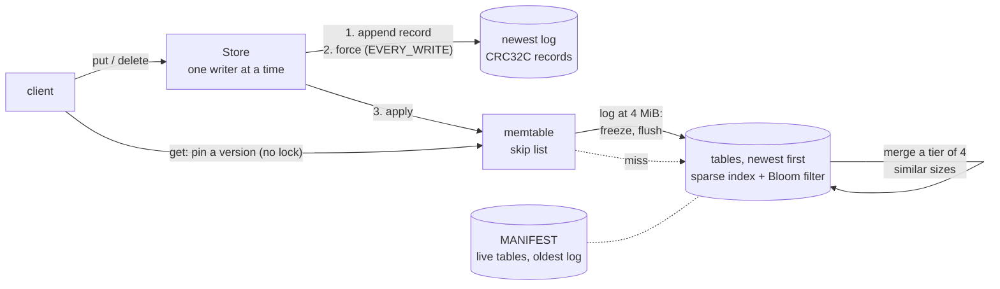

# Keystore

An LSM-tree key-value store in Java 21, built the way LevelDB and RocksDB are: a write-ahead log with CRC32C
checksums, an in-memory skip list, SSTables with a sparse index and Bloom filters, and size-tiered compaction; then
(from day 3) a TCP server and leader-follower replication by log shipping.

**Status: day 2 of 5.** Day 1 built the write path's foundation: the memtable (a hand-written skip list with
lock-free reads), the write-ahead log, crash recovery, and `put`/`get`/`delete`. Day 2 made it an LSM tree: the
memtable is flushed to immutable tables when the log reaches 4 MiB, a manifest names the live tables, reads go
through the memtable and then the tables newest first, and tables of similar size are merged. No external
dependencies beyond JUnit. [DESIGN.md](DESIGN.md) has the design and the plan for days 3–5.

## Why

Storage engines are mostly about what happens when things go wrong: a crash in the middle of a write, a flush that
fails, a bit that flips on disk. This project tries to be exact about those cases, with tests that create each one,
rather than only getting the happy path fast. Every claim below has a test or a command next to it.

## Architecture



- **Write path.** A write is appended to the log, forced to the device under `SyncPolicy.EVERY_WRITE` (the default),
  applied to the memtable, and only then acknowledged. When the log has reached 4 MiB, the write first flushes: the
  log is forced and a new one started, the memtable is frozen and written to a table, and a new manifest names the
  table. Then any tier of four similar-sized tables is merged into one.
- **Read path.** `get` takes no lock: it pins an immutable version (the memtable, the frozen memtable, the tables)
  and looks in that order, newest first. A table whose key range or Bloom filter rules the key out costs no disk
  read; otherwise its sparse index names the one 4 KiB block to read.
- **Recovery.** Opening a store reads the manifest, checks its tables, and replays only the logs the tables don't
  cover. In the newest log, the longest run of good records is applied and what follows the first bad record is
  classified: damage with nothing intact after it is a torn tail, which is what a crash leaves, and is truncated;
  damage followed by intact records means writes were made after it, and the store refuses to open (by default)
  rather than silently drop them. Then files the manifest doesn't account for are deleted.

The details, and why each choice was made, are in [DESIGN.md](DESIGN.md).

## Run it

Java 21 and Maven 3.9 or later. On this machine Maven's default JDK is newer, so point it at Java 21:

```bash
export JAVA_HOME=/opt/homebrew/opt/openjdk@21
```

Build and run the tests (the CI on Ubuntu and macOS runs the same command):

```bash
mvn verify
```

The `keystore` command works on a store directory (after `mvn package`):

```bash
scripts/keystore put target/demo city Boston
```

```bash
scripts/keystore flush target/demo
```

```bash
scripts/keystore get target/demo city
```

```bash
scripts/keystore delete target/demo city
```

```bash
scripts/keystore dump target/demo
```

`get` prints `Boston`, read from the table the flush wrote. `dump` reads the manifest and the logs without changing
anything; after those four commands it prints:

```
target/demo/MANIFEST: tables cover writes up to #1; logs start at 000002.log; next file number 4
  000003.sst: 152 bytes, writes #1 to #1
target/demo/000002.log: 25 bytes
         0  #2 delete city
clean: 25 bytes, every one a good record
```

For a log the store would refuse to open, it shows where the damage is and lists the intact records after it, the
ones `RecoveryMode.POINT_IN_TIME` would drop, and exits with status 3.

From Java:

```java
try (Store store = Store.open(Path.of("target/demo"))) {
    store.put(Bytes.utf8("k"), Bytes.utf8("v"));
    Optional<byte[]> value = store.get(Bytes.utf8("k"));
    store.delete(Bytes.utf8("k"));
}
```

## Tests

`mvn verify` runs them all; the tests that make each failure happen are the interesting ones:

| What | Test |
|---|---|
| The skip list behaves like `TreeMap` under random puts and gets, and its structure holds at every level | `SkipListTest` |
| Readers running alongside the writer see every insert the writer had finished (a happens-before edge through a counter makes a miss a real bug) | `SkipListConcurrencyTest` |
| The record format, byte for byte, against a CRC-32C written out bit by bit; every single-bit flip is caught | `WalFormatTest` |
| A log cut at every byte recovers exactly the whole records before the cut; a flip in any bit of any record is classified correctly | `WalReaderTest` |
| Truncation is on disk and forced; a refused open leaves the file untouched | `WriteAheadLogTest` |
| The store against a `HashMap` model across reopens, concurrent writers, a torn tail, damage refused then dropped | `StoreTest` |
| A child JVM can't open a directory this JVM holds, even after a refused second open here (the POSIX lock trap) | `StoreLockTest` |
| A child JVM can't open the directory through a second real path (a macOS firmlink), a rename, or a second class loader | `StoreLockTest` |
| A write that fails partway, a failed flush, and an interrupted writer each stop writes until a reopen; close forces what it must; a write past the log's limit is refused | `StoreFaultTest` |
| `EVERY_WRITE` forces every write before it returns, `NEVER` only at close | `SyncPolicyTest` |
| Every new directory's parent, the log's directory on every open, and a truncation are forced; a refused open leaks no file descriptor | `DurabilityTest` |
| 200 crash-and-recover cycles (a write dying at a random byte, zero or garbage tails) leave exactly the acknowledged writes, 3 seeds | `CrashCycleTest` |
| The `keystore` command, including a read-only dump of a damaged log | `MainTest` |
| **Day 2** | |
| Tables: every entry reads back; random tables answer every key, prefix and extension as a `TreeMap` does; every bit flip, every cut and two swapped blocks are caught; a crafted index count is refused | `TableTest` |
| The Bloom filter's false-positive rate is near the formula's; its hash matches the reference C code | `BloomFilterTest` |
| The manifest round-trips, every bit flip and cut is caught, a torn temp file leaves the old one, inconsistent fields are refused | `ManifestTest` |
| Reads across the memtable and tables, newest wins, tombstones hide older values; merges keep the count down; a flush failing at the manifest loses nothing; no manifest or a damaged table refuses the open | `StoreTablesTest` |
| Which adjacent tables a merge takes | `CompactionTest` |
| 360 crash-and-recover cycles with faults anywhere (appends, tables, the manifest, directory forces), 249 crashes, against the acknowledged writes | `TableCrashCycleTest` |
| A flush and a merge force each file they must, in order | `DurabilityTest` |
| Four readers alongside constant flushes and merges never miss a key or read a stale value; no file is left open or behind | `StoreConcurrencyTest` |

Most of the mechanisms these tests cover were also checked the other way round: removed in a copy of the file, a
test had to fail, and the file was restored. DESIGN.md, "Testing", lists which.

## Results

Measured on an Apple M3 (macOS 26.6, the internal SSD, APFS) with Homebrew OpenJDK 21.0.12, on power, with nothing
else running: `scripts/bench.sh 5` at `1ace995`, which prints one line per run. Each figure is the median of 5
runs, each run after a warm-up run in the same JVM. These are plain wall-clock timings, not JMH (that's day 4).

| What | Median of 5 | Command (`Bench` is `java -cp target/classes:target/test-classes io.github.vivekdavara.keystore.bench.Bench`) |
|---|---|---|
| A 128-byte append, then `fsync`, in C | p50 26 µs, p99 64 µs | `target/fsync_cost target 1000` |
| A 128-byte append, then `fcntl(F_FULLFSYNC)`, in C | p50 2,994 µs, p99 3,591 µs | same |
| `put` under `EVERY_WRITE` (16-byte key, 100-byte value) | 361 writes/s; p50 2,990 µs, p99 3,977 µs | `Bench writes EVERY_WRITE 1000 100` |
| `put` under `NEVER` | 525,217 writes/s; p50 1.7 µs, p99 4.2 µs | `Bench writes NEVER 200000 100` |
| Recovery: open a store whose log holds 1,000,000 puts (141.0 MB) | 284 ms: 3.5 million records/s, 496 MB/s | `Bench recover 1000000 100` |
| The scan after damage, over a 64 MiB tail of zeros | 60 ms (1,113 MB/s) | `Bench scan 67108864 zeros` |
| The same over a 64 MiB tail of random bytes | 75 ms (895 MB/s) | `Bench scan 67108864 random` |
| Memtable heap per key, structure only (node, next pointers, entry) | 64.2 bytes | `Bench memory 1000000 100` |
| Skip list, 1,000,000 inserts then lookups, one thread | 877,000 inserts/s, 781,000 lookups/s | `Bench skiplist 1000000` |
| `ConcurrentSkipListMap`, the same | 892,000 inserts/s, 870,000 lookups/s | same |

Rechecked at `d63a17a`, after the review's fixes, with the same commands: `NEVER` 504,305 to 525,399 writes/s
(3 runs), `EVERY_WRITE` 355 to 360 writes/s with a median put of 2,990 µs (3 runs), recovery of the 1,000,000 puts
278 ms (1 run). All within the spread above.

What the numbers say:

- **A durable write costs one drive-cache flush.** `EVERY_WRITE`'s median put (2,990 µs) is the C program's
  `F_FULLFSYNC` (2,994 µs), and a plain `fsync` would be about a hundred times cheaper (26 µs) but doesn't flush the
  drive's cache. That `FileChannel.force` issues `F_FULLFSYNC` on macOS is checked in the JDK's own code
  (DESIGN.md, "Appending"). `NEVER` is about 1,450 times faster because it never waits for the device. Group commit,
  sharing one flush among concurrent writers, is the usual way between the two (day 4).
- **Recovery reads at about 500 MB/s**, so replaying a 64 MB log (a plausible memtable) takes about a tenth of a
  second. The range across the 5 runs was 257 to 517 ms.
- **The scan that tells a torn tail from damage costs about a millisecond per megabyte** over zeros or random bytes:
  most offsets fail on the length or the op byte. A value built to look like records at every offset is decided by
  the scan's budget (see "Review of day 1").
- **The hand-written skip list is close to the JDK's** for inserts (2% slower, median) and 10% slower for lookups.
  The run-to-run spread is wide (lookups 653,000 to 843,000 a second), so these are rough.
- **Holding next pointers in a plain array, through a `VarHandle`**, instead of an `AtomicReferenceArray`
  (`3707eca`): 16 bytes less per key (80.2 to 64.2, `Bench memory`), and inserts went from 726,000 to 881,000 a
  second (median of 5 alternating pairs of runs, the old build in a worktree at `ef9cb7e`). Lookups didn't improve:
  744,000 before and 722,000 after, within the noise. My guess that the extra pointer hop slowed lookups was wrong,
  or at least not measurable this way.

## Review of day 1

Two review agents went over the day's code at `b28ac73`, one on the log and recovery, one on the memtable and the
store's concurrency, each in its own git worktree. They reported only what they had reproduced, and I reproduced
each finding again before fixing it. Every fix has a test that fails without it.

- **Two stores could write one log, and an acknowledged write was lost** (both reviews found it). The set of
  directories open in this JVM was keyed by real path, but one directory can have two: a macOS firmlink
  (`/System/Volumes/Data/private/var/...`), a Linux bind mount, or a rename. The second open passed the set, its
  failed `tryLock` closed a channel on `LOCK`, and POSIX released the first store's lock. Now the set is keyed by
  the directory's file key (device and inode), and a channel whose lock attempt overlaps one this JVM holds is kept
  open, never closed (a second class loader, with a set of its own, reaches that path).
- **Recovery could take minutes.** The scan after damage was quadratic over a value built to look like log records
  at every offset: 16.9 s for a 4 MiB torn value (reproduced here), and 275 s for 16 MiB in the review's run. It now has a checksum
  budget; when it runs out, recovery can't rule out writes after the damage, so the default refuses (0.03 s).
- **The store acknowledged writes it could never recover**, past the 2 GiB recovery reads whole. `Options.maxLogBytes`
  is now checked before anything is written.
- **`lastSequence()` named a write before reads could see it**, while it was still being forced.
- **Close under `NEVER` skipped the force after a failed append**, and returned normally.
- **The log's directory wasn't forced if a crash came between creating the file and forcing it**, and only one of
  several new parent directories was forced.
- **The memtable's count of bytes written** left out each record's framing, 22 times too small for 1-byte deletes,
  though the design said the flush would use it. It's gone; the flush will use the log's size.
- **Tests that passed with their mechanism removed:** every force (truncation, directories, close), the channel
  close on a refused open, close's write lock, and an in-place replacement that readers never saw. Each now has a
  test that fails without it.
- **Not fixable by a test:** a plain write where a volatile one belongs in the skip list passed the concurrency test
  100 times in 100; the counter that makes the test's checks exact also hides a missing edge. That property rests on
  the argument in DESIGN.md, and would need a jcstress-style harness to test.

## Review of day 2

Two review agents started on the day's code at `6314e01`, one on the table format and recovery, one on the store's
flushes, merges and concurrency, each in its own git worktree. Both were cut off by an account usage limit after
about six minutes. The first had already written its findings as tests, which I reproduced and fixed:

- **Two data blocks of the same length, swapped, passed every check**, and a lookup in such a block answered "not
  here" for a key the table has: a store read would fall through to an older table and return an overwritten value.
  The block checksum covered the block's bytes but not where they were. It now covers the offset too, so a block
  found in the wrong place (a misdirected write, say) fails its checksum.
- **A crafted table whose checksums were all valid could claim an index of 2^31 blocks**, and the reader allocated
  arrays for them before noticing the index was far too short, dying of an `OutOfMemoryError`. The count is now
  checked against the index's length first, and block lengths against the data region.
- Its oracle test (random tables over keys on both sides of 0x80, every prefix and extension of every key probed)
  and its maximum-length-key test passed, and are now part of `TableTest`.

Found while building: **one interrupted `get` broke a table for every reader.** `FileChannel` is interruptible, so
the interrupt closed the table's channel, and every later read of that table failed with `ClosedChannelException`
until a reopen (a probe showed it). A table now reopens its channel when a read finds it closed while the table is
still live; the interrupted read still fails.

The second agent left nothing, so it was run again after the limit reset, on failure handling during flushes and
merges (below, if it found anything).

## Design decisions

- **A hand-written skip list, one writer, lock-free readers.** Writes are serialised anyway (one log), so the skip
  list only needs to be safe for one writer and many readers. It fills in a node, then links it bottom-up with
  volatile writes, so a reader can never reach a half-built node. This is LevelDB's model.
- **Fail closed on damage in the middle of the log.** Recovery tells a torn tail (normal after a crash) from damage
  followed by intact records (writes would be lost). The default refuses the second; `POINT_IN_TIME` drops it on
  request; `keystore dump` shows what would go.
- **Sequence numbers are checked on replay.** A checksum can't catch an intact record in the wrong place; a gap or a
  repeat in the sequence can.
- **A failed write stops all writes.** After a failed append or flush the log's state is unknown (and a retried
  flush can falsely succeed: PostgreSQL's "fsyncgate"), so the store refuses further writes until it is reopened.
- **One process per directory, enforced twice.** A `LOCK` file with an OS lock, and a JVM-wide set of open
  directories keyed by file key, because POSIX locks are per process and closing any descriptor releases them.
- **Bounded, fail-closed recovery.** The scan that tells a torn tail from damage has a budget; when it can't decide,
  it refuses rather than guess.
- **The manifest is the only list of live files, rewritten whole and renamed into place.** Anything it doesn't
  name is garbage, deleted once recovery has succeeded; a directory with tables but no manifest is refused rather
  than opened as a new store, which would delete them.
- **Immutable versions with reference counts for reads.** A read pins one snapshot of the memtable, the frozen
  memtable and the tables, so it never sees a key between two places, and a table a merge dropped stays open until
  the last read in it is done. A read costs one atomic increment and one decrement.
- **Size-tiered compaction over adjacent tables only.** Each table covers a contiguous range of sequence numbers, so
  newest-first is a valid read order; merging only adjacent tables keeps it so. Tombstones are dropped only by a
  merge that reaches the oldest table.
- **Block checksums that cover the block's offset**, so a block in the wrong place fails like a damaged one.
- **Flush before the write that finds the log full**, not after, so a failed flush fails a write that was never
  made.

## Limitations

- Flushes and merges run in the writing thread, under the write lock: the write that triggers one waits for it
  (reads don't). Background compaction is day 4's, with group commit.
- Writes are serialised, and under `EVERY_WRITE` each waits for its own device flush; there is no group commit yet.
- A merge takes a whole tier, so it needs as much free space as the tier; tombstones live until a merge reaches the
  oldest table.
- No block cache, no compression, no range scans or snapshots yet.
- Damage that reaches the end of the log is indistinguishable from a torn write, so it is dropped as one, however
  many records it covers.
- A value that holds an encoded log record can make recovery refuse to open after an ordinary crash; the default
  errs on the side of refusing (a test shows the case).
- Interrupting a writing thread closes the log's channel and stops the store's writes until a reopen. (An
  interrupted reader only fails its own read.)

DESIGN.md's "Limitations" has the full list.

## License

MIT. See [LICENSE](LICENSE).
