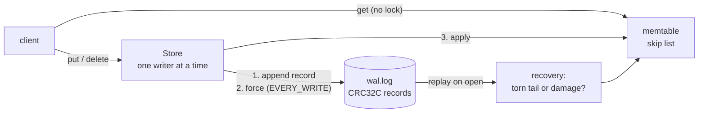

# Keystore

An LSM-tree key-value store in Java 21, built the way LevelDB and RocksDB are: a write-ahead log with CRC32C
checksums, an in-memory skip list, and (from day 2) SSTables with Bloom filters and size-tiered compaction, then a
TCP server and leader-follower replication by log shipping.

**Status: day 1 of 5.** Day 1 is the write path's foundation: the memtable (a hand-written skip list with lock-free
reads), the write-ahead log, crash recovery, and `put`/`get`/`delete` on top. Everything lives in memory and in one
log file; SSTables come on day 2. [DESIGN.md](DESIGN.md) has the design and the plan for days 2–5.

## Why

Storage engines are mostly about what happens when things go wrong: a crash in the middle of a write, a flush that
fails, a bit that flips on disk. This project tries to be exact about those cases, with tests that create each one,
rather than only getting the happy path fast. Every claim below has a test or a command next to it.

## Architecture



- **Write path.** A write is appended to the log, forced to the device under `SyncPolicy.EVERY_WRITE` (the default),
  applied to the memtable, and only then acknowledged.
- **Read path.** `get` reads the memtable without taking a lock.
- **Recovery.** Opening a store replays the log: the longest run of good records is applied, and what follows the
  first bad record is classified. Damage with nothing intact after it is a torn tail, which is what a crash leaves:
  it is truncated and the store opens. Damage followed by intact records means writes were made after it: the store
  refuses to open (by default) rather than silently drop them.

The details, and why each choice was made, are in [DESIGN.md](DESIGN.md).

## Run it

Java 21 and Maven 3.9 or later. On this machine Maven's default JDK is newer, so point it at Java 21:

```bash
export JAVA_HOME=/opt/homebrew/opt/openjdk@21
```

Build and run the tests (the CI on Ubuntu and macOS runs the same command):

```bash
mvn verify
```

The `keystore` command works on a store directory (after `mvn package`):

```bash
scripts/keystore put target/demo city Boston
```

```bash
scripts/keystore get target/demo city
```

```bash
scripts/keystore delete target/demo city
```

```bash
scripts/keystore dump target/demo
```

`get` prints `Boston`. `dump` reads the log without changing it; after those three commands it prints:

```
target/demo/wal.log: 60 bytes
         0  #1 put city (6 bytes)
        35  #2 delete city
clean: 60 bytes, every one a good record
```

For a log the store would refuse to open, it shows where the damage is and lists the intact records after it, the
ones `RecoveryMode.POINT_IN_TIME` would drop, and exits with status 3.

From Java:

```java
try (Store store = Store.open(Path.of("target/demo"))) {
    store.put(Bytes.utf8("k"), Bytes.utf8("v"));
    Optional<byte[]> value = store.get(Bytes.utf8("k"));
    store.delete(Bytes.utf8("k"));
}
```

## Tests

`mvn verify` runs them all; the tests that make each failure happen are the interesting ones:

| What | Test |
|---|---|
| The skip list behaves like `TreeMap` under random puts and gets, and its structure holds at every level | `SkipListTest` |
| Readers running alongside the writer see every insert the writer had finished (a happens-before edge through a counter makes a miss a real bug) | `SkipListConcurrencyTest` |
| The record format, byte for byte, against a CRC-32C written out bit by bit; every single-bit flip is caught | `WalFormatTest` |
| A log cut at every byte recovers exactly the whole records before the cut; a flip in any bit of any record is classified correctly | `WalReaderTest` |
| Truncation is on disk and forced; a refused open leaves the file untouched | `WriteAheadLogTest` |
| The store against a `HashMap` model across reopens, concurrent writers, a torn tail, damage refused then dropped | `StoreTest` |
| A child JVM can't open a directory this JVM holds, even after a refused second open here (the POSIX lock trap) | `StoreLockTest` |
| A write that fails partway, a failed flush, and an interrupted writer each stop writes until a reopen | `StoreFaultTest` |

## Design decisions

- **A hand-written skip list, one writer, lock-free readers.** Writes are serialised anyway (one log), so the skip
  list only needs to be safe for one writer and many readers. It fills in a node, then links it bottom-up with
  volatile writes, so a reader can never reach a half-built node. This is LevelDB's model.
- **Fail closed on damage in the middle of the log.** Recovery tells a torn tail (normal after a crash) from damage
  followed by intact records (writes would be lost). The default refuses the second; `POINT_IN_TIME` drops it on
  request; `keystore dump` shows what would go.
- **Sequence numbers are checked on replay.** A checksum can't catch an intact record in the wrong place; a gap or a
  repeat in the sequence can.
- **A failed write stops all writes.** After a failed append or flush the log's state is unknown (and a retried
  flush can falsely succeed: PostgreSQL's "fsyncgate"), so the store refuses further writes until it is reopened.
- **One process per directory, enforced twice.** A `LOCK` file with an OS lock, and a JVM-wide set of open
  directories, because POSIX locks are per process and closing any descriptor releases them.

## Limitations

- Day 1 keeps everything in memory and never trims the log; SSTables, log rotation and compaction are day 2.
- Writes are serialised, and under `EVERY_WRITE` each waits for its own device flush; there is no group commit yet.
- Damage to the last record is indistinguishable from a torn write, so it is dropped as one.
- A value that holds an encoded log record can make recovery refuse to open after an ordinary crash; the default
  errs on the side of refusing (a test shows the case).
- Interrupting a writing thread closes the log's channel and stops the store's writes until a reopen.

DESIGN.md's "Limitations" has the full list.

## License

MIT. See [LICENSE](LICENSE).
